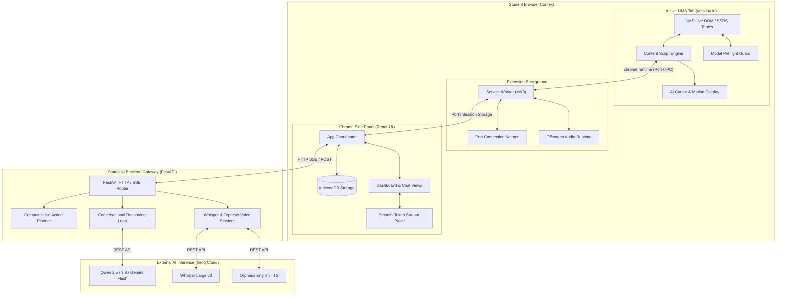

# LPU AI Copilot: System Architecture & Data Flow

**Document:** ARCHITECTURE.md  
**Scope:** Chrome Extension Manifest V3, Content Perception Pipeline, Service Worker IPC, Backend Inference Gateway, and Storage Layer.

---

## 1. High-Level Architecture Overview

The system operates on an asymmetric, privacy-preserving client-server model:
- **Perception & Action (Client):** Executes directly within the student's authenticated browser context on `ums.lpu.in`.
- **Reasoning & Planning (Server):** Operates statelessly, taking structured DOM element abstracts and answering queries without retaining student identifiers.



---

## 2. Chrome Extension Manifest V3 Architecture

### A. Lifecycle Management & Port Keep-Alive
Chrome MV3 service workers terminate after 30 seconds of inactivity. To ensure uninterrupted operation during complex agent navigations or voice playback:
1. **Long-Lived Messaging Ports:** The Side Panel creates a dedicated `chrome.runtime.Port` upon opening (`name: "lpu_copilot_port"`).
2. **Heartbeat Protocol:** The side panel issues a ping every 25 seconds across the port. The Service Worker responds immediately, resetting the MV3 idle timer.
3. **Tab Focus Listener:** `chrome.tabs.onActivated` and `chrome.tabs.onUpdated` send synchronization messages to re-evaluate portal state when students switch tabs.

### B. Offscreen Audio Pipeline
Chrome Manifest V3 prohibits direct microphone access and background audio playback within service workers.
- The extension employs the `chrome.offscreen` API.
- An offscreen document (`offscreen.html` / `offscreen.ts`) is created dynamically with reasons: `["AUDIO_PLAYBACK", "USER_MEDIA"]`.
- Spoken responses and microphone PCM audio are streamed via structured message passing between the Side Panel, Service Worker, and Offscreen runtime.

---

## 3. DOM Perception & Grounding Pipeline

The content script translates noisy HTML into a structured coordinate map:

```
[Live UMS Page] ──► [pageObserver.ts] ──► [Element Harvesting]
                           │
                           ├─► Assign unique id: 'copilot-001'
                           ├─► Compute bounding box: [x, y, w, h]
                           ├─► Extract semantic role & label
                           └─► Filter non-interactive elements
                                      │
                                      ▼
                        [PageObservation Data Contract]
                                      │
              ┌───────────────────────┴───────────────────────┐
              ▼                                               ▼
    [Local Heuristic Match]                        [Backend LLM Planner]
    (Instant 0ms click match)                      (Vision-grounded reasoning)
```

### Perception Contract: `PageObservation`
```typescript
export interface PageObservation {
  url: string;
  pageType: 'LOGIN' | 'DASHBOARD' | 'ATTENDANCE_MODAL' | 'DATE_SHEET' | 'TIMETABLE' | 'UNKNOWN';
  hasCampusDriveModal: boolean;
  hasAttendanceTable: boolean;
  isExamPage: boolean;
  elements: ActionableElement[];
  timestamp: number;
}

export interface ActionableElement {
  id: string; // e.g. "copilot-001"
  tag: string;
  role: string;
  text: string;
  ariaLabel?: string;
  rect: { x: number; y: number; width: number; height: number; centerX: number; centerY: number };
  isVisible: boolean;
  isInteractive: boolean;
}
```

---

## 4. Autonomous Action Engine & Bézier Trajectories

To avoid abrupt, robotic clicks that break dynamic single-page portal apps:
1. **Trajectory Generator (`agentMotion.ts`):** Calculates a cubic Bézier curve between current cursor coordinates $(x_0, y_0)$ and the target element center $(x_1, y_1)$ with random control point offsets to simulate human motor control.
2. **Easing Function:** Uses cosine smoothstep acceleration and deceleration.
3. **Native Event Dispatch (`actionEngine.ts`):** Emits mouse movement, mouse down, mouse up, and click events sequentially.

---

## 5. Storage Architecture (On-Device IndexedDB)

All data is structured across four independent IndexedDB object stores within database `LpuCopilotDB`:

```
┌────────────────────────────────────────────────────────────────────────┐
│                        INDEXEDDB STORE SCHEMA                          │
├─────────────────────┬──────────────────┬───────────────────────────────┤
│ Store Name          │ Key Path         │ Indexes                       │
├─────────────────────┼──────────────────┼───────────────────────────────┤
│ attendance_records  │ id (auto)        │ timestamp, regNo              │
│ examination_records │ id (auto)        │ termCode, updatedAt           │
│ timetable_slots     │ id (auto)        │ dayOfWeek, courseCode         │
│ chat_conversations  │ conversationId   │ updatedAt, pinStatus          │
│ execution_traces    │ executionId      │ timestamp, status             │
└─────────────────────┴──────────────────┴───────────────────────────────┘
```

---

## 6. Security & Credential Isolation

1. **Client-Side:** The extension never handles or prompts for UMS passwords. It operates strictly inside the student's active authenticated tab.
2. **Server-Side:**
   - `GROQ_API_KEY`: Strictly restricted to primary chat and Computer Use navigation.
   - `GROQ_VOICE_API_KEY`: Isolated strictly to Whisper STT and Orpheus TTS endpoints.
   - Per-request stateless processing: zero user logs or session payloads are written to disk.
